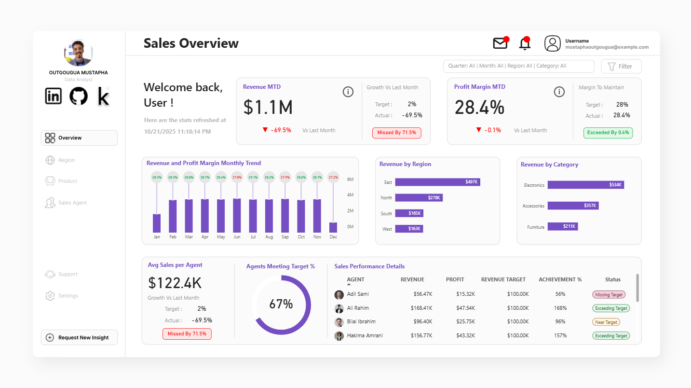

# Sales Performance & Profitability Analytics Dashboard

[](https://app.powerbi.com/view?r=eyJrIjoiMjBmYTFjYWItODI3Yy00YWM2LTljNjItYmNjNjliNzA5MGY4IiwidCI6Ijg0ZDI3MGQyLTBiYzUtNGQ1NS1iZjBhLTI3NGYxYTU3NmNiZiJ9)
[](docs/PRD.md)
[](#data-modeling--schema)
[](#key-dax-measures)

An end-to-end Power BI analytics solution engineered to analyze, monitor, and optimize revenue streams, order volumes, and gross margins across commercial sales channels.

---

## Interactive Live Report
Access the fully functional, interactive Power BI report directly in your browser:

<a href="https://app.powerbi.com/view?r=eyJrIjoiMjBmYTFjYWItODI3Yy00YWM2LTljNjItYmNjNjliNzA5MGY4IiwidCI6Ijg0ZDI3MGQyLTBiYzUtNGQ1NS1iZjBhLTI3NGYxYTU3NmNiZiJ9" target="_blank" rel="noopener noreferrer">Launch Interactive Sales Dashboard</a>

---

## Table of Contents
1. [About This Project](#about-this-project)
2. [Product Requirements Document (PRD)](#product-requirements-document-prd)
3. [Dashboard Architecture & Visual Interface](#dashboard-architecture--visual-interface)
4. [Data Modeling & Schema](#data-modeling--schema)
5. [Key DAX Measures](#key-dax-measures)
6. [Business Insights & Strategic Recommendations](#business-insights--strategic-recommendations)
7. [Repository Structure](#repository-structure)
8. [Author & Contact](#author--contact)

---

## 1. About This Project

Commercial organizations commonly face reporting silos, fragmented transactional spreadsheets, and delayed visibility into unit profitability. When leadership evaluates top-line gross revenue without contextual cost and margin data, unprofitable volume growth often masks underlying operational inefficiencies.

This project delivers a centralized business intelligence layer designed to solve that problem. Built with **Microsoft Power BI**, it translates raw transactional line items into an executive-level performance engine that surfaces the "why" behind commercial variance across time, geography, customer tiers, and product hierarchies.

### Core Deliverables
* **Executive Summary View:** High-level scorecard tracking overall revenue health, net margin trends, and order volumes.
* **Geographical & Category Drill-Downs:** Detailed visual slices enabling regional and category managers to isolate margin drag.
* **Governed Semantic Layer:** A clean Star Schema backed by explicit, performant DAX business logic.

---

## 2. Product Requirements Document (PRD)

To ensure technical development aligned with concrete business objectives rather than arbitrary visual design, the dashboard was built against a structured Product Requirements Document.

* **Full Specification:** [docs/PRD.md](docs/PRD.md)

### Key Requirements Satisfied
* **Automated Data Processing:** Standardized ingestion and transformation via Power Query to clean historical transactional records.
* **Standardized Metric Definitions:** Unified calculations for Revenue, Gross Margin, Average Order Value (AOV), and Quantity Sold.
* **Actionable Analytical Paths:** Navigation structured to allow users to move from global KPIs down to regional and product-line root causes within three clicks.

---

## 3. Dashboard Architecture & Visual Interface

### Executive Performance Overview
The main interface consolidates critical metrics, tracking commercial trajectory alongside categorical contribution:



*A complete, high-resolution exported artifact is available at [`Image/Sales Dashboard.pdf`](Image/Sales%20Dashboard.pdf).*

---

## 4. Data Modeling & Schema

The data model is structured in a strict **Star Schema** to ensure fast analytical processing, maintain referential integrity, and eliminate ambiguous filter propagation:
```text
                         +-------------------+
                         |     Dim_Date      |
                         +-------------------+
                                   | 1
                                   | 
                                   | *
+-------------------+     +-------------------+     +-------------------+
|   Dim_Product      |----|    Fact_Sales      |----|   Dim_Customer    |
+-------------------+ 1   +-------------------+   1 +-------------------+
         | *
         |
         | 1
+-------------------+
|   Dim_Geography   |
+-------------------+
```
* **`Fact_Sales` (Fact Table):** Captures atomic transaction lines, including quantities, unit selling prices, standard costs, and discount values.
* **`Dim_Product`:** Hierarchical categorization covering categories, sub-categories, and SKU identifiers.
* **`Dim_Geography`:** Regional, country, and city mappings for geographic slicing.
* **`Dim_Customer`:** Account metadata and segment groupings.
* **`Dim_Date`:** A dedicated, continuous calendar dimension marked as the official Date Table to guarantee accurate time intelligence calculations.

---

## 5. Key DAX Measures

Business logic is implemented via modular, formatted DAX measures grouped into a dedicated calculation table:

```dax
// 1. Total Net Sales
Total Sales = 
SUM(Fact_Sales[SalesAmount])

// 2. Total Cost of Goods Sold (COGS)
Total Cost = 
SUM(Fact_Sales[TotalCost])

// 3. Gross Profit
Total Profit = 
[Total Sales] - [Total Cost]

// 4. Gross Profit Margin Percentage
Profit Margin % = 
DIVIDE([Total Profit], [Total Sales], 0)

// 5. Total Transactions (Orders)
Total Orders = 
DISTINCTCOUNT(Fact_Sales[OrderNumber])

// 6. Average Order Value (AOV)
Average Order Value = 
DIVIDE([Total Sales], [Total Orders], 0)

// 7. Year-over-Year Revenue Growth
Sales YoY Growth % = 
VAR _PriorYearSales = 
    CALCULATE(
        [Total Sales], 
        SAMEPERIODLASTYEAR(Dim_Date[Date])
    )
RETURN
    DIVIDE([Total Sales] - _PriorYearSales, _PriorYearSales, 0)
```

## 6. Business Insights & Strategic Recommendations
An analytical audit of the resulting data patterns reveals several structural levers for commercial management:

### 1. Address Top-Line Volume vs. Margin Dilution
* **Finding:** While specific high-volume product categories account for substantial gross revenue, their net profit margin falls below 12%, driven by heavy baseline discounting and promotional price erosion.

* **Actionable Recommendation:** Institute a dynamic discounting cap for tier-one accounts and pivot sales incentives from pure volume (units sold) to gross margin contribution. Shifting volume toward higher-margin complementary SKUs can recover an estimated 200–350 basis points of gross margin.

### 2. Capitalize on Regional Unit Economics
* **Finding:** Core metropolitan regions generate over 60% of total revenue but demonstrate plateauing Average Order Values (AOV). Conversely, emerging secondary territories exhibit smaller total volume but a 15% higher AOV per transaction.

* **Actionable Recommendation:** Implement cross-selling and bundling campaigns in primary urban hubs to expand basket size, while directing targeted field sales expansion toward high-AOV secondary markets where each new customer acquisition yields higher operational leverage.

### 3. Normalize Period-End Revenue Spikes
* **Finding:** Significant surges in transaction volume materialize during the final 10 days of each financial quarter, frequently followed by higher return rates and administrative processing friction in the subsequent month.

* **Actionable Recommendation:** Transition operational and demand forecasting to 30-day moving rolling averages rather than static end-of-quarter quotas. Rebalancing pipeline targets across monthly milestones will ease supply chain stress and stabilize fulfillment overhead.


## 7. Repository Structure
```
├── Data/
│   └── Sales Data.xlsx             # Source transactional data extract
├── docs/
│   └── PRD.md                      # Complete Product Requirements Document
├── Image/
│   ├── Overview2.png               # High-resolution dashboard screenshot
│   └── Sales Dashboard.pdf         # Complete exported multi-page report
└── README.md                       # Main repository overview and documentation
```

---

## 8. Author & Contact

**OUTGOUGUA MUSTAPHA**

Data Analyst | Power BI Developer | Business Intelligence Specialist

- 💼 [LinkedIn](https://www.linkedin.com/in/mustapha-outgougua/)
- 🐙 [GitHub](https://github.com/outgouguamustapha)
- 📧 Open to collaboration and opportunities

---


<div align="center">

**If you found this project insightful, please consider giving it a ⭐!**

Made with ❤️ and Power BI

</div>
